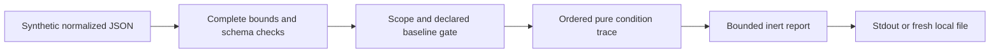

# HTTP Precondition Lab

An offline Python teaching model of origin-side HTTP preconditions over declared
synthetic snapshots. It explains strong/weak ETag comparisons, existence, method
outcomes and tag/date precedence. No HTTP request, response, resource operation or
cache update is performed. A continue result is not authorization or actual success.

## Run

Verified on Windows CPython 3.13.7. No third-party runtime dependencies.
Run from this directory:

```powershell
python -m preconditionlab fixtures/cases.json
python -m preconditionlab fixtures/cases.json --format markdown --output new-demo.md
python -m unittest discover -s tests -v
python -O -m unittest discover -s tests -v
python tools/verify.py --output reports/new-verification
```

The full 32-case demo exits **2** because four cases are unsupported; it still emits
all results. Supported documents exit 0, including hypothetical 304/412/bypass results.
Invalid input or I/O failure exits 1; argument-syntax errors separately exit 2.
Output paths must be fresh; existing files and input aliases are rejected. The verifier
requires the existing Bandit installation and a new own-project evidence directory;
it installs nothing and has no network fallback.

Public API:

```python
from pathlib import Path
from preconditionlab import parse, evaluate

report = evaluate(parse(Path("fixtures/cases.json").read_bytes()))
print(report["results"][1]["trace"])
```

`parse()` handles bounded byte/JSON syntax; `evaluate()` validates the entire concrete
document before decisions, including unsupported cases. Reporter helpers accept only
evaluated records, not arbitrary untrusted objects. No generator/custom-object coercion.

## Demonstration

| Case | Hypothetical outcome | Key lesson |
|---|---|---|
| match-strong | Continue normal processing | Both tags strong and same opaque value |
| match-weak-request | 412 suggestion | A weak tag cannot satisfy strong comparison |
| empty-opaque-present | Continue | Empty tag is distinct from no tag |
| none-weak-get | 304 suggestion | Retrieval uses weak comparison |
| none-weak-put | 412 suggestion | Method changes the failed-condition outcome |
| match-suppresses-date | Continue | Tag presence suppresses the date alternative |
| earliest-failure | 412 suggestion | Later present conditions are not reached |
| baseline-forbidden | Supplied 403 bypass | Normal-check failure takes precedence |
| informational-unsupported | Unsupported | 1xx is not a completed baseline result |

The [JSON demo](reports/verification-reviewed/demo.json) and
[Markdown demo](reports/verification-reviewed/demo.md) contain every trace field
and fixed assumptions. The trace deliberately distinguishes ABSENT, NOT_REACHED,
ignored alternatives, PASS/FAIL and unknown/bypassed context. It does not report
raw tags, headers or bodies. IDs are escaped even when they contain report punctuation.



[CONTRACT.md](CONTRACT.md) freezes field shapes, supported combinations, trace priority
and error semantics. [PLAN.md](PLAN.md) records approved stages and addendum.
[RESEARCH.md](RESEARCH.md) inspects actual Werkzeug development/aiohttp source and
explains why an original normalized model fits this scope. Reference:
[RFC 9110 conditional requests](https://httpwg.org/specs/rfc9110.html#conditional.requests).

## Security and limitations

Only GET/HEAD/PUT/DELETE and specified normal success/existence combinations are
supported. Other completed status classes may bypass the algorithm as declared
hypothetical baseline checks; 1xx and baseline 412 are unsupported. Tag structures
are supplied, not parsed from HTTP. ASCII case/backslash/empty/star data remain exact;
bounded non-ASCII tag context is unsupported, while invalid ASCII characters reject.
Date fields are comparable synthetic integer seconds, not actual HTTP-date parsing
or evidence of synchronized clocks. The representation snapshot is a teaching assumption.

No authentication, actual lost-update protection, atomic check-and-write, body hashing,
negotiation, raw-header parser, already-applied exception, Range/If-Range, response
sending, cache revalidation/304 merging, server/browser or full RFC conformance.
Do not treat ETags as cryptographic authentication or infer equality of real bodies
from the supplied markers. A real origin must supply appropriate consistency and
resource-specific semantics; this application never observes or enforces them.

Input/API bounds and escaping protect this local teaching interface, not an OS
isolation boundary. Paths/host process are trusted. No hostile filesystem-race, hard
memory/time or atomic stdout/durability guarantee. Output failures can leave partial
stdout; fresh-file errors attempt cleanup and disclose cleanup failure.
See [SECURITY.md](SECURITY.md) for exact boundaries.

## Verification and learning

25 tests pass in normal and optimized Python, including optimized CLI children;
32 frozen cases (28 supported/four unsupported); compile and Bandit pass. Five
narrow fixed-command test/verifier B404/B603 suppressions, no application suppression.
Three targeted mutations are caught by fixture assertions (3/1/2 failures), restored
by exact bytes, then 25 tests pass. Closed-consumer stdout tested at four buffer sizes;
the test permits completed writes before reader closure, otherwise requires error exit 1.
Output cap tested at an honest reporter seam, not asserted reachable from valid input.

[VERIFICATION.md](VERIFICATION.md) and [REVIEW.md](REVIEW.md) provide exact evidence
and implementing-agent ECC self-review limits. No unresolved scoped application finding;
manual boundary review remains pending. No Linux/other-runtime, upstream test execution,
hosted CodeQL/CI, dedicated secret/history scan or live origin/browser assurance.
No repository created, published or merged; unrelated parent/earlier work preserved.

[DECISIONS.md](DECISIONS.md) records choices; [LEARNING.md](LEARNING.md) explains the
reasoning. Optional exercise: explain why an empty ETag can satisfy a list condition,
while an absent ETag can still satisfy a wildcard condition when existence is true.

## License and AI assistance

MIT, copyright 2026 Jake. Strict parser/reporter/CLI/verifier patterns adapted from
Jake's MIT HTTP-cache/CORS labs, which remain unchanged. No Werkzeug/aiohttp code
or upstream vectors copied; research documents their license/dependency obligations.
Codex implemented, reviewed and tested this lab. Local Ollama qwen3.5:2b extracted
three supplied definitions (770 ms); two accepted, ambiguous strong wording corrected
against the standard. It did not generate the oracle or make security judgments.
Raw and reviewed drafts remain separate. No remote model/provider/spending.

## Publication status

See [publication review](PUBLICATION.md) for the October 5 source snapshot, fresh local checks, evidence boundaries and current hosted-check distinction.
